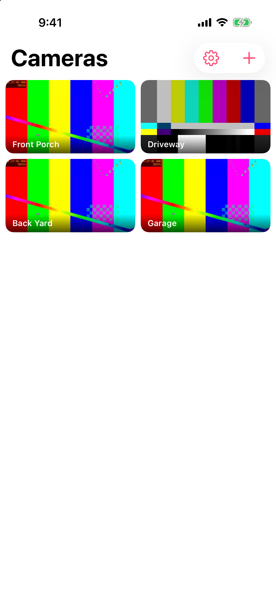

# CamFetti

Your cameras, live, in one tap. A free, open-source iPhone app for Thingino, ONVIF and RTSP cameras.



- Thingino cameras show up by name (Bonjour `_thingino._tcp`). Other brands turn up in a scan of the Wi-Fi.
- Video decodes on the iPhone's hardware (H.264 and H.265) through IPCamKit and AVSampleBufferDisplayLayer.
- Thingino controls: day/night mode and drag-to-pan, signed in once with the camera's web password.
- ONVIF and brand templates for Reolink, Hikvision, Dahua, Amcrest, Tapo and more.
- Picture in Picture, snapshots to Photos, audio (G.711, AAC, L16).
- Away from home through Tailscale or any VPN: each camera can have an away address.
- No account, no analytics, no servers. Passwords live in the Keychain.

Website: https://camfetti.lacy.sh

## Build

Needs Xcode 26+ and [XcodeGen](https://github.com/yonaskolb/XcodeGen).

```sh
xcodegen generate
open CamFetti.xcodeproj
```

## Test

The tests use a local rig of fake cameras: MediaMTX serving H.264, H.265 and audio, plus a fake Thingino web API that announces itself over Bonjour.

```sh
brew install mediamtx ffmpeg
rig/start.sh
xcodebuild test -scheme CamFetti -destination 'platform=iOS Simulator,name=iPhone 17 Pro'
rig/stop.sh
```

Rig integration tests skip themselves when the rig isn't running.

## Layout

| Folder | What |
|---|---|
| `Sources/Streaming` | RTSP session loop, sample buffers, audio, Picture in Picture |
| `Sources/Integrations` | Thingino API, ONVIF, brand templates, the add-camera prober |
| `Sources/Discovery` | Bonjour browse and subnet sweep |
| `Sources/UI` | SwiftUI screens |
| `rig` | Fake cameras for tests |
| `site` | camfetti.lacy.sh |

## Contributing

Bug reports and pull requests are welcome. See [CONTRIBUTING.md](CONTRIBUTING.md), which covers the contributor agreement.

## License

GPL-3.0. See [LICENSE](LICENSE). The App Store build is distributed by the copyright holder under Apple's terms.

The CamFetti name and icon aren't part of the license, so a fork needs its own.
